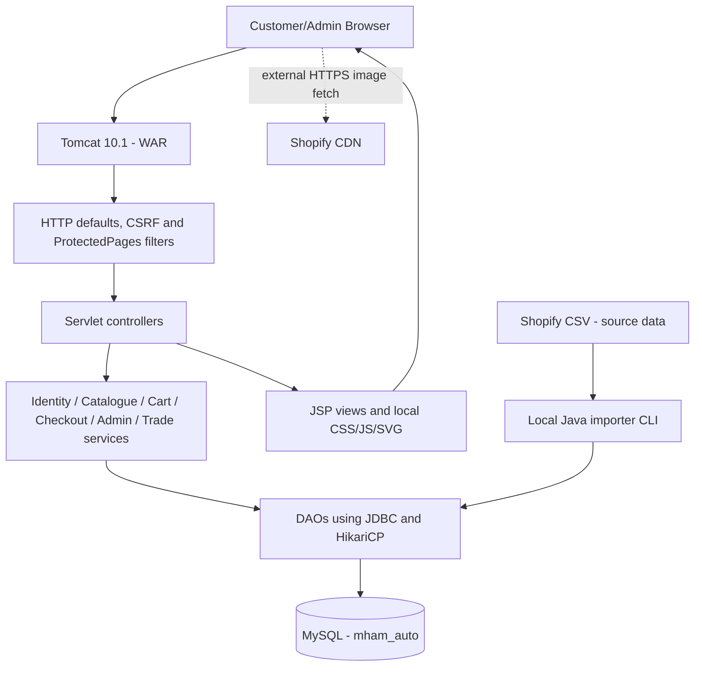

# Architecture and runtime flows

MHAM AUTO | Academic V1 | Phase 11 | Release candidate RC1 | 28 October 2026

## System overview
MHAM AUTO uses a Java 21 MVC-style **modular monolith** with Maven WAR packaging for Apache Tomcat 10.1.61. Browser HTML/CSS/vanilla JS and JSP views call annotated Servlets and filters. Services perform business rules and authorization; JDBC DAOs read and write MySQL InnoDB. There are no payment, courier, CRM or remote inventory services.

## Modules and important source locations
- `com.mhamauto.servlet`: web controllers, annotated routes and JSP dispatch.
- `com.mhamauto.filter`: default security headers, protected routes and refreshed account permissions.
- `com.mhamauto.auth`: identity, password hashing, session and CSRF utilities.
- `com.mhamauto.catalog`: read-only product queries, filtering, pagination and detail retrieval.
- `com.mhamauto.cart`: customer-specific, transactional persistent cart.
- `com.mhamauto.checkout`: Kuwait address checks, cart price evaluation, idempotent demo order and immutable snapshot storage.
- `com.mhamauto.account`: profile and owner-scoped customer order queries.
- `com.mhamauto.admin`: basic product/category/inventory and demo order management.
- `com.mhamauto.trade`: business applications and controlled admin review.
- `com.mhamauto.importer` and `com.mhamauto.dao`: Shopify CSV parsing/import and source-tracking.
- `com.mhamauto.db`: JDBC configuration, HikariCP and six schema migrations.
- `src/main/webapp/WEB-INF/views`: protected JSP templates, reusable fragments; static resources under `assets`.

## Primary customer flow
1. Guest accesses public catalogue and sees active, Kuwait-visible products.
2. Customer registers or logs in; HttpSession is regenerated and server role/active status verified.
3. Cart writes require authenticated user, CSRF token and positive bounded quantities. Server determines KWD amounts.
4. Demo checkout verifies saved address belongs to customer, all lines have permitted fictional/verified KWD price and valid quantity; writes order and immutable item/address snapshots in one transaction; empties cart.
5. Customer may view only their own orders and addresses. No payment/stock reservation/dispatch occurs.

## Primary administrator flow
- Admin role is granted with explicit local bootstrap; user registration does not grant ADMIN.
- Protected Servlet routes reject non-admin access; writes require CSRF token and validation.
- Product/category updates, fictional pricing and sample stock changes do not rewrite earlier order snapshots.
- B2B application status PENDING -> APPROVED/REJECTED is a demo review only; not a trade entitlement.

## Important integrity decisions
- `BIGINT` product, variant, media, customer and order IDs; source handles and SKUs are separate immutable business references.
- SKU remains string; raw source currency/price retained and not silently converted to KWD.
- MySQL stores media URL and relationship metadata only; original image files remain on Shopify CDN.
- `DECIMAL(18,3)` and `BigDecimal` preserve KWD fils; no floating-point currency arithmetic.
- Prepared statements, bounded pagination, authorization and domain ownership checks.
- Historical migration checksums and fresh-install reproducibility.

## Performance boundaries
Indexed handles/SKUs, constrained page sizes, direct CDN image delivery and a small bounded JDBC pool support academic testing. A 1M+ product catalogue is an *architecture target only*, not a benchmarked deployment or an assurance of acceptable latency at that volume.
