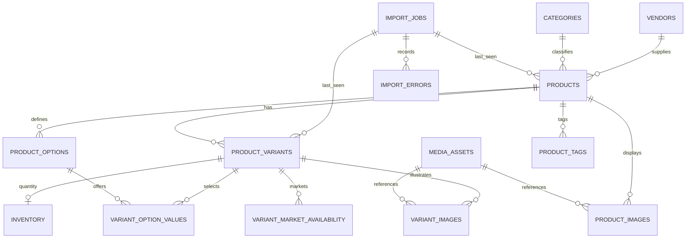

# Phase 2 data model — normalized Shopify catalogue

## Identity and source rules
- The authoritative product grouping key is **Shopify Handle**. It is immutable source identity for this importer, stored in a case-sensitive unique collation. Every imported product also receives an internal BIGINT primary key.
- The current import requires a nonblank **Variant SKU** to identify a sellable variant. It is stored verbatim with a case-sensitive unique index, including source apostrophes, until a deliberate normalization policy is approved. Image-only rows can have no SKU.
- Multiple CSV rows may share a handle. They join an existing `product_id`, while multiple SKUs create variant rows and separate `variant_option_values`.
- `media_assets` deduplicates by SHA-256 of the original HTTPS source URL; `product_images` and `variant_images` are junctions. The same URL can represent one media asset referenced by multiple products. Image files are never fetched or stored in MySQL.
- Images use `source_position` for ordering. Wrong source alt text is kept separately from `alt_text_override` (future editor). Optional variant images can be mapped by variant SKU. Missing SKU on an image-only row means the variant association is intentionally not inferred.
- Unmodeled Shopify fields are preserved in the external archived CSV identified by `import_jobs.source_sha256`, not in heavyweight 74-column product tables.
- Source inventory remains `verified_live=FALSE`. It cannot be interpreted as reserved or salable stock.
- Unknown source price currency: `source_price_text` retains raw amount; `retail_price_kwd` is NULL. Only a separately confirmed KWD source file enables 3-decimal KWD values. Non-KWD conversion requires a future approved import policy.

## Scale and operational characteristics
- BIGINT IDs, InnoDB FKs, parameterized statements, transaction savepoints, bounded 250-row commits and source/audit metadata.
- Indexed: handle, variant SKU, product visibility, vendor/category filters, product images order and full-text product title.
- Use query-plan (`EXPLAIN`) review and keyset pagination when Phase 3 adds product search to actual JSP pages.
- Index addition and schema changes must be versioned. Keep mysql DATA (database) and HTTP media payloads separate.
- At 1M+ products, measure throughput, storage, image availability and search response time; add a dedicated search service only on observed query needs, not in Academic V1.

## Future table additions (NOT in Phase 2)
Identity and commerce modules are intentionally deferred to their roadmap stages: `users`, `roles`, `customer_addresses`, `carts`, `cart_items`, `orders`, `order_items`, and optional `business_applications`. They will reference the stable internal product/variant IDs and use separate migrations, while the Phase 2 catalogue tables remain.
